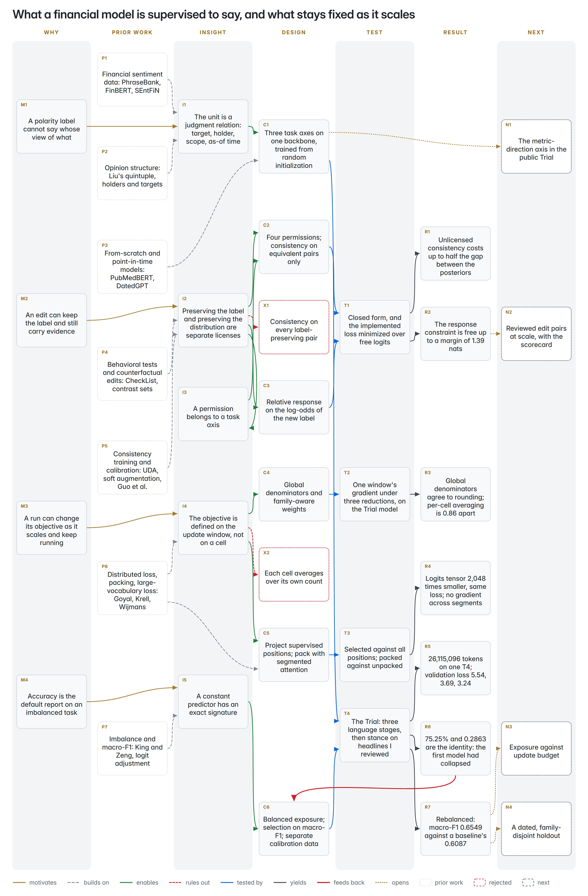

<p align="center"></p>

# Financial Large Language Model: Semantic Permissions and Objective-Preserving Scaling

**Letao (Theodore) Ouyang** · Independent research · November 2026

[Article](manuscript/semantic-permissions-and-objective-preserving-scaling.md) · [PDF](paper/paper.pdf) · [Results](reproduce/results.md) · [Derivations](docs/derivations.md) · [Design notes](docs/design-notes.md) · [Research route](docs/research-route.md) · [Literature](docs/literature.md)

**What should a financial language model be supervised to say, and what must stay fixed while its training scales?**

Financial text packs three things into one sentence: a change in a fact, the author's attitude, and an action. A
sentiment label compresses them into positive or negative, and a model trained on it learns cue words while
answering the wrong question. I built a financial language model around a different object, a judgment relation:
who expresses which view of what, on which evidence, as of when, and what would change it. The
model exists at two scales, a 2.4B-parameter version that I use for research and a 24M-parameter Trial that is
public here, trained from random initialization on one Tesla T4. Two designs carry it. **Financial semantic
permissions** state, for every edit of a text and every task axis, what the model's output may and must do.
**Objective-preserving scaling** is a training contract under which an update has one objective however it is
executed.

## Three results to start with

| Result | Why it matters | Where |
| --- | --- | --- |
| A consistency term on a pair that keeps its label moves both predictions off their calibrated values by the same amount, up to **half the gap** between the two true posteriors: 0.70 and 0.90 become **0.79 and 0.81** at a strength of 1. A one-sided response term on log-odds costs a calibrated model **nothing** at any margin up to 1.39 nats | Preserving the label and preserving the distribution are two licenses. Consistency training merges them, and in finance the edits that keep a label are the edits that carry evidence | [§2, §3](manuscript/semantic-permissions-and-objective-preserving-scaling.md) · [D1](docs/derivations.md#d1-the-price-of-unlicensed-consistency) · [D2](docs/derivations.md#d2-the-relative-response-constraint-is-free-for-a-calibrated-model) |
| With global denominators the gradient of one update is the same from four ranks of two microbatches as from a single batch, to about **10⁻⁶**; per-cell averaging on the same cells puts it **0.86** away. Projecting only the supervised positions leaves the loss unchanged with a logits tensor **2,048** times smaller | A run can change its objective as it scales and keep running. Under the contract the gradient is a function of the recipe and the data, and every change of execution has an equivalence check | [§4, §5](manuscript/semantic-permissions-and-objective-preserving-scaling.md) · [D3](docs/derivations.md#d3-one-update-one-objective) · [D6](docs/derivations.md#d6-projecting-only-supervised-positions) |
| The Trial's first stance model scored **75.25%** accuracy by answering neutral every time, and its macro-F1 of **0.2863** is the constant predictor's identity to the last digit. Rebalanced, the model reaches **0.6549** against a TF-IDF baseline's 0.6087, by gaining 17 directional examples and giving up 14 neutral ones | A score is read against what a predictor with no knowledge of the task would score, and a gain against what it cost | [§6](manuscript/semantic-permissions-and-objective-preserving-scaling.md) · [D8](docs/derivations.md#d8-a-constant-predictor-has-an-exact-signature) |

All 179 figures in the article are recomputed in [results](reproduce/results.md).

## The problem

Financial sentiment analysis has a standard form: a sentence receives one of three polarity labels, and models are
compared on agreement with those labels. One sentence shows what the label leaves out.

> Company A's revenue grew year over year, but I am still reducing my position in A.

The metric moved up. The author's investment stance is bearish. A single label has to pick one of these, and a
model trained on it has no way to know which was picked. The consequence is measured in the literature: an attack
that inverts the financial meaning of a sentence through targeted lexical substitutions deceives FinBERT in 90.85%
of eligible cases, and on aspect-level sentiment, test sets that separate the target aspect from the others reduce
the accuracy of nine models by up to 69.73%. The models respond to words where they should respond to relations.

Scaling has a failure of its own, and it is silent. Running text supervises almost every token, a stance example
supervises one, and an optimizer update is assembled from ranks, accumulation microbatches and packed sequences. A
reduction that averages inside each piece trains a different objective from the recipe, the loss still falls, and
nothing in the curve says so.

## The idea

**A judgment relation is the unit of supervision.** Every example names what the judgment is about, whose view it
is, the evidence it may rest on and the time at which that evidence was known:

```math
\big(\text{text},\ \text{target},\ \text{holder},\ \text{scope},\ t_{\text{as of}}\big) \;\longmapsto\; y_j
\quad \text{for task axis } j .
```

Three axes share one backbone: the investment stance a named holder expresses, the direction of a metric against
an explicit comparator, and my own judgment. The model is trained from random initialization, so the texts I later
label are excluded before the tokenizer exists.

**An edit carries a permission on each axis.** The permission says what the edit may and must do to the output.

| Permission | The label | The distribution | Loss on the pair |
| --- | --- | --- | --- |
| Equivalent | preserved | preserved | consistency |
| Label-preserving | preserved | free to move | none |
| Relabel $`a \to b`$ | changes | changes | relative response |
| Unconstrained | not related | not related | none |

Changing "grew" to "fell" in the sentence above relabels the metric-direction axis and keeps the stance label;
changing "reducing" to "adding to" does the opposite. On a pair with class logits $`z, z'`$ the loss is

```math
\begin{gathered}
\ell(x, x') = \mathrm{CE}(z, y) + \mathrm{CE}(z', y')
+ \lambda_E\,𝟏[\text{equivalent}]\,\lVert \bar z - \bar z' \rVert^2
+ \lambda_R\,𝟏[\text{relabel}]\,\max(0,\ m - D), \\
D = (z'_b - z'_a) - (z_b - z_a) ,
\end{gathered}
```

where $`D`$ is the change across the edit in the log-odds of the new label against the old one.

**An update has one objective.** Let the window be everything consumed between two optimizer steps. For term
$`j`$ with weight $`\lambda_j`$, loss sum $`S_j`$ and count $`C_j`$ over the whole window the objective is
$`L = \sum_j \lambda_j S_j / C_j`$. Split the window into cells, one per rank $`r`$ and microbatch $`k`$, and let
each contribute

```math
\ell_{rk} = W \sum_{j} \lambda_j\,\frac{S_{rk,j}}{C_j},
\qquad \frac{1}{W}\sum_{r}\sum_{k} \nabla \ell_{rk} = \nabla L ,
```

with $`W`$ ranks. The identity holds for every partition of the window. Execution is then free to change anything
the objective does not see: where the vocabulary head is applied, how examples are packed, how the update is
split.

## Results

**The price of unlicensed consistency.** Take a pair whose true posteriors are $`p`$ and $`p'`$ and apply a
consistency term of strength $`\lambda`$ to the predictions $`q`$ and $`q'`$. At the optimum

```math
q - p \;=\; p' - q' \;=\; \lambda\,\big(\mathrm{logit}\,q' - \mathrm{logit}\,q\big) \;=\; \varepsilon(\lambda),
\qquad 0 < \varepsilon(\lambda) < \frac{\left\vert p' - p\right\vert}{2} .
```

An edit adds a second reason for a bullish view, and a calibrated reader moves from 0.70 to 0.90:

| Consistency strength | 0 | 0.03 | 0.1 | 0.3 | 1 | 3 | 10 | $`\infty`$ |
| --- | ---: | ---: | ---: | ---: | ---: | ---: | ---: | ---: |
| Prediction at the original | 0.700 | 0.728 | 0.756 | 0.779 | 0.793 | 0.797 | 0.799 | 0.800 |
| Prediction at the edited text | 0.900 | 0.872 | 0.844 | 0.821 | 0.807 | 0.803 | 0.801 | 0.800 |
| Calibration error at each end | 0 | 0.028 | 0.056 | 0.079 | 0.093 | 0.097 | 0.099 | 0.100 |

A true equivalence has $`p = p'`$ and pays nothing at any strength, which is why the consistency term is licensed
for equivalent pairs only. The response term is the opposite case: at the calibrated predictor $`D`$ is at least
$`2\ln\,r`$ when both labels were assigned at posterior odds of at least $`r`$, so with $`r = 2`$ the hinge is zero
for every margin up to 1.39 nats, and a model that does not respond pays the full margin.

**The contract, measured on the Trial model.** A window of 16 sequences holds 756 language positions, 16 answer
positions and 2 stance positions.

| Reduction | Relative difference from the single-batch gradient |
| --- | ---: |
| Global denominators, 4 ranks × 2 microbatches | about 10⁻⁶ |
| Per-cell averaging, same cells | 0.86 |

The first figure is single-precision rounding. The second is a different objective: the stance term sits in one
cell of eight and keeps an eighth of its weight.

**Execution that preserves the objective.** Projecting only the supervised positions, with the full vocabulary,
gives the same loss and the same gradients as projecting every position. At the 2.4B configuration's microbatch
the logits tensor goes from 1 GiB to 0.5 MiB. Restricting the softmax to the label tokens is a different loss,
short by exactly the log of the probability mass on those tokens. With segmented causal attention on a rotary
model, three packed examples receive logits within 10⁻⁵ of their unpacked values, against differences of 2.9
under plain causal attention, and the gradient across a segment boundary is exactly zero.

**The Trial, end to end.** A 6-layer decoder of 24,255,744 parameters, trained on one Tesla T4.

| Stage | Updates | Supervised tokens | Validation loss |
| --- | ---: | ---: | ---: |
| Seed | 300 | 4,914,941 | 5.542 |
| Expansion on new general text | 1,220 | 19,988,195 | 3.693 |
| Financial adaptation | 74 | 1,211,960 | 3.238 |
| **Total** | | **26,115,096** | |

All 10,686 distinct headlines of the pool I would later label were excluded from the tokenizer's input and from
every corpus before training began. I then reviewed 2,000 of them for investment stance toward a named target.

| Development, 101 examples | Accuracy | Macro-F1 |
| --- | ---: | ---: |
| First model, neutral for every example | 75.25% | 0.2863 |
| Class-weighted logistic regression on TF-IDF | 75.25% | 0.6087 |
| Rebalanced model | 78.22% | 0.6549 |

A predictor that always answers the largest of $`K`$ classes, with share $`\pi`$, scores accuracy $`\pi`$ and
macro-F1 $`\tfrac{1}{K}\cdot\tfrac{2\pi}{1+\pi}`$. The first model's two scores are that identity, so its 75.25%
carried no information about the task. The rebalanced model classified 17 more directional examples correctly and
14 fewer neutral ones: accuracy moved by three examples and macro-F1 by 0.3687.

**Two scales, one contract.**

| | 24M Trial | 2.4B |
| --- | ---: | ---: |
| Parameters | 24,255,744 | 2,397,459,968 |
| Layers / hidden size | 6 / 512 | 28 / 2,560 |
| Vocabulary / context | 8,192 / 512 | 65,536 / 4,096 |

Both counts follow from one formula. The task protocol, the permissions, the contract and the error analysis carry
from one scale to the other; the vocabulary, the weights, the training state and the calibration are rebuilt.

## What is new

Financial sentiment models, behavioral tests, consistency training and distributed training are established lines
of work. What I built:

1. **A judgment relation as the unit of supervision.** Target, holder, evidence scope and as-of time on every
   example, with stance, metric direction and my own judgment as separate axes. Entity-level corpora attach a
   consensus label to an entity, and stance corpora label an author's expectation for a stock. The relation makes
   the holder, the scope and the date fields of the example, and the labels follow one analyst's standard.
2. **Financial semantic permissions.** Four permissions, assigned per edit and per task axis, as terms of the
   training objective. Behavioral testing separates invariance tests from directional ones, and contrast sets
   supply label-changing edits, as instruments of evaluation. One flag per edit cannot say that the same edit
   relabels one axis and is an equivalence on another.
3. **The price of unlicensed consistency, in closed form.** Consistency training treats a label-preserving
   transformation as distribution-preserving. The theorem gives what that costs: equal and opposite calibration
   errors, growing with the strength up to half the gap between the true posteriors.
4. **A response constraint that is free for a calibrated model.** A one-sided hinge on the change in log-odds,
   with a safe margin of $`2\ln\,r`$ from the odds at which labels are assigned.
5. **A training contract over terms of unequal density.** The total-minibatch rule of distributed training covers
   one loss term. The contract covers several, under any partition into ranks and microbatches, with views
   averaged inside families, and it is measured on the model.
6. **An equivalence check for every change of execution.** Projection at supervised positions with the full
   vocabulary, the exact gap to a label-restricted loss, and packing without contamination on a decoder with
   rotary positions.
7. **The exact signature of a constant predictor.** Two scores identify a model that has learned nothing about
   the task, and the exchange between classes is reported beside the gain.
8. **A boundary on the task as well as on the corpus.** Point-in-time models bound what a model has read by date.
   Here the texts to be labelled are excluded before the tokenizer is trained.

[Where this work sits](docs/literature.md) sets each of these against the closest prior work, and the
[bibliography](docs/bibliography.md) lists all 150 sources.

## How the argument was built

<picture>
  <source media="(prefers-color-scheme: dark)" srcset="assets/route-dark.png">
  
</picture>

The route is a network. What the model is supervised to say and how the training is executed were worked out
against each other, and one result went back and changed the design.

- **What an edit may do.** Keeping the label and keeping the distribution turned out to be two licenses, which
  ruled out consistency on every label-preserving pair and produced the four permissions.
- **What scaling may not change.** Defining the objective on the update window ruled out per-cell averaging, and
  gave each change of execution a check.
- **What a score means.** The first stance model landed on the constant predictor's identity. That result set the
  selection rule: balanced exposure in training, macro-F1 and per-class recall for selection, calibration on
  separate data.

The [research route](docs/research-route.md) explains all 39 steps and all 40 links.

## If you train or evaluate a financial language model

| If you | The article shows | Do this |
| --- | --- | --- |
| Train on polarity labels | One sentence holds a rising metric and a bearish author | Name the target, the holder, the scope and the date, and give each question its own axis |
| Add a consistency loss on augmented pairs | It costs up to half the gap between the true posteriors | License it for equivalent pairs only, and use a one-sided response term where the label changes |
| Scale a multi-term loss over devices and accumulation | Per-cell averaging changed the gradient by 0.86 | Normalize each term by its count over the whole update window |
| Supervise a few positions per sequence | The full-vocabulary loss needs logits at those positions only | Project the supervised positions, and keep the softmax over the whole vocabulary |
| Pack short examples | Plain causal attention moves logits by 2.9 | Mask attention across segments; rotary positions need no reset |
| Report accuracy on an imbalanced task | 75.25% was a constant predictor | Compare both scores with the majority identity, and report what each class gained and gave up |
| Need to bound what a model has seen | 10,686 task texts were excluded before the tokenizer existed | Train from random initialization and fix the exclusion first |

## Repository

| Path | Contents |
| --- | --- |
| [`manuscript/`](manuscript/semantic-permissions-and-objective-preserving-scaling.md) | The article |
| [`paper/paper.pdf`](paper/paper.pdf) | The article as a PDF |
| [`docs/derivations.md`](docs/derivations.md) | Every proof in full, D1 to D10 |
| [`docs/design-notes.md`](docs/design-notes.md) | Each design choice, the alternative it beat, and how the Trial was run |
| [`docs/research-route.md`](docs/research-route.md) | The logic of the work as a network, node by node |
| [`docs/literature.md`](docs/literature.md) · [`docs/bibliography.md`](docs/bibliography.md) | Where the work sits, and the 150 sources |
| [`src/finllm/`](src/finllm) · [`tests/`](tests) | The 24M Trial: model, tokenizer, trainer, evaluation and inference; the permission loss and scorecard; the contract's reductions and execution paths; 119 tests |
| [`configs/`](configs) | One configuration per training stage |
| [`evidence/`](evidence/README.md) | The Trial's measurements |
| [`reproduce/`](reproduce/README.md) | Code that recomputes every figure in the article, and the [results](reproduce/results.md) |

## Materials

Every measured figure comes from the 24M Trial; figures for the 2.4B configuration are exact arithmetic on its
configuration and its training recipe. The Trial's decoder is adapted from MiniMind at revision `f659b55`; the
attribution is in [THIRD_PARTY_NOTICES](THIRD_PARTY_NOTICES.md). General text is a prefix of one fixed English
Wikipedia revision, financial text is the minutes of the Federal Open Market Committee from 2011 to 2025, and the
stance labels are my own review of headlines from SEntFiN.

## Citation

Letao (Theodore) Ouyang, *Financial Large Language Model: Semantic Permissions and Objective-Preserving Scaling*
(2026), <https://github.com/130U/RESEARCH-Financial-Large-Language-Model/blob/main/paper/paper.pdf>. See
[CITATION.cff](CITATION.cff).

[theodore.oy2025@gmail.com](mailto:theodore.oy2025@gmail.com) · [10@alumni.duke.edu](mailto:10@alumni.duke.edu)

© Letao (Theodore) Ouyang. Released under the [Apache 2.0 license](LICENSE).
