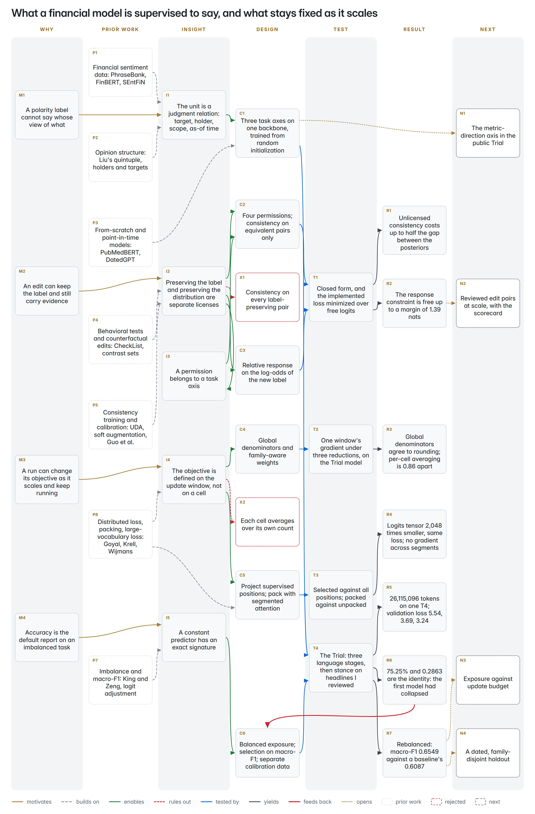

# Research route

How the argument was built: which observation forced which design choice, where a result went back and changed the
design, and what each result opens. The work did not run from problem to solution in one line. What the model is
supervised to say and how the training is executed were worked out against each other, because a supervision
design is only as good as the runtime's ability to train exactly it.

<picture>
  <source media="(prefers-color-scheme: dark)" srcset="../assets/route-dark.png">
  
</picture>

## Reading the figure

Columns are kinds of step, not stages in time. A link can run between any two columns, and one runs backwards,
from a result to the design.

| Link | Meaning |
| --- | --- |
| motivates | A need or an insight that made the next step necessary |
| builds on | A published result the step starts from |
| enables | A step that makes another one possible |
| tested by / yields | A design and the test that checks it; a test and what it produced |
| feeds back | A result that changed the design |
| rules out | A finding that excludes an alternative |
| opens | A design or result that sets up the next experiment |

Solid boxes are my own steps. Dotted boxes are prior work, red dashed boxes are alternatives I rejected, and grey
dashed boxes are the experiments that come next. Design boxes are numbered C1 to C6 so that they are not confused
with the derivations D1 to D10.

## The four threads

### 1. What the model is asked

M1 → I1 → C1 → T4.

A polarity label cannot say whose view of what it records (M1). Financial sentiment data attaches the label to a
sentence or to an entity (P1), and opinion mining has long described an opinion as an entity, an aspect, a
sentiment, a holder and a time (P2). I made that structure the unit of supervision (I1): every example names a
target, a holder, an evidence scope and an as-of time. A relation with several answers becomes several task axes
on one backbone (C1), stance, metric direction and my own judgment, and the model is trained from random
initialization, which is what lets the texts that will be labelled be excluded before the tokenizer exists (P3).
The whole path was run end to end at 24M parameters (T4).

### 2. What an edit may do

M2 → I2 → C2, C3 → T1 → R1, R2, with I2 ruling out X1 and I3 feeding C2.

An edit can keep the label and still carry evidence (M2). Behavioral testing separates perturbations that should
change nothing from perturbations with a known effect (P4), and consistency training turns the first kind into a
loss (P5). The insight is that keeping the label and keeping the distribution are two licenses (I2), and that a
permission belongs to a task axis (I3). So there are four permissions, with a consistency term on equivalent
pairs only (C2), and a one-sided response term on the log-odds of the new label for relabelling pairs (C3).
Consistency on every label-preserving pair is rejected (X1).

The test is closed form, with the implemented loss minimized as a check (T1). A consistency term on two
calibrated posteriors moves both toward each other by the same amount, up to half their gap: 0.70 and 0.90 become
0.79 and 0.81 at a strength of 1 (R1, [D1](derivations.md#d1-the-price-of-unlicensed-consistency)). The response
term is zero at the calibrated predictor for margins up to 1.39 nats when labels are assigned at odds of at least
2 (R2, [D2](derivations.md#d2-the-relative-response-constraint-is-free-for-a-calibrated-model)).

### 3. What scaling may not change

M3 → I4 → C4, C5 → T2, T3 → R3, R4, with I4 ruling out X2.

A run can change its objective as it scales and keep running (M3). Distributed training already has the rule for
one loss term, normalize by the total minibatch, and packing and large-vocabulary loss have their own techniques
(P6). The objective is defined on the update window (I4), so each term is normalized by its count over the whole
window, with views averaged inside families (C4), and per-cell averaging is rejected (X2). Execution may change
only what the objective does not see: the vocabulary head runs on supervised positions with the full vocabulary,
and packed examples attend inside their own segment (C5).

On the Trial model the gradient of one window is the same from four ranks of two microbatches as from a single
batch, to single-precision rounding, and 0.86 apart under per-cell averaging (T2, R3,
[D3](derivations.md#d3-one-update-one-objective), [D4](derivations.md#d4-what-per-cell-averaging-does)).
Projecting supervised positions leaves the loss and its gradients unchanged with a logits tensor 2,048 times
smaller, and no gradient crosses a segment boundary (T3, R4,
[D6](derivations.md#d6-projecting-only-supervised-positions),
[D7](derivations.md#d7-segmented-attention-on-a-rotary-model)).

### 4. What a score means

M4 → I5 → C6 → T4 → R5, R6, R7, with R6 feeding back into C6.

Accuracy is the default report on an imbalanced task (M4, P7). A constant predictor has an exact signature in
accuracy and macro-F1 (I5, [D8](derivations.md#d8-a-constant-predictor-has-an-exact-signature)). The Trial trained
the language model in three stages on one T4, 26,115,096 supervised tokens (R5), and its first stance model scored
75.25% accuracy and 0.2863 macro-F1, the identity to the last digit (R6). That result set the design (R6 → C6):
exposure balanced in training, selection on macro-F1 and per-class recall, calibration on separate data. The
rebalanced model reaches 0.6549 against a TF-IDF baseline's 0.6087, by gaining 17 directional examples and giving
up 14 neutral ones (R7).

## From results to the next experiments

| Next | Comes from | What it settles |
| --- | --- | --- |
| N1 The metric-direction axis in the public Trial | C1 | The second axis on the same backbone, with its own labels |
| N2 Reviewed edit pairs at scale, with the scorecard | R2 | The pair loss against cross-entropy on the same pairs |
| N3 Exposure against update budget | R7 | Which of the two changes recovered the directional classes |
| N4 A dated, family-disjoint holdout | R7 | The selected model on headlines it was not selected on |

## Every node

| Node | Column | What it is |
| --- | --- | --- |
| **M1** A polarity label cannot say whose view of what | Why | One sentence can hold a rising metric and a bearish author. A single label has to pick, and the model cannot know which was picked. |
| **M2** An edit can keep the label and still carry evidence | Why | A second reason for the same view leaves the answer unchanged and should raise the confidence. |
| **M3** A run can change its objective as it scales and keep running | Why | The code runs and the loss falls while ranks, microbatches and packing have altered what is being optimized. |
| **M4** Accuracy is the default report on an imbalanced task | Why | Three quarters of the development examples are neutral, so a model can score 75% by answering neutral. |
| **P1** Financial sentiment data: PhraseBank, FinBERT, SEntFiN | Prior Work | Malo et al. (2014), Araci (2019), Sinha et al. (2022): one polarity label per sentence or per entity, assigned by consensus. |
| **P2** Opinion structure: Liu's quintuple, holders and targets | Prior Work | Liu (2012): an opinion is an entity, an aspect, a sentiment, a holder and a time. |
| **P3** From-scratch and point-in-time models: PubMedBERT, DatedGPT | Prior Work | Gu et al. (2020), He et al. (2025a), Yan et al. (2026): training from scratch is how a model's reading is bounded. |
| **P4** Behavioral tests and counterfactual edits: CheckList, contrast sets | Prior Work | Ribeiro et al. (2020), Gardner et al. (2020), Kaushik et al. (2019): edits with a known effect on the answer, used to test and to collect data. |
| **P5** Consistency training and calibration: UDA, soft augmentation, Guo et al. | Prior Work | Xie et al. (2019), Liu et al. (2022), Guo et al. (2017): invariance as a loss; confidence that should soften with the input; temperature scaling. |
| **P6** Distributed loss, packing, large-vocabulary loss: Goyal, Krell, Wijmans | Prior Work | Normalize by the total minibatch; pack without cross-contamination; compute the loss without materializing the logits. |
| **P7** Imbalance and macro-F1: King and Zeng, logit adjustment | Prior Work | King and Zeng (2001), Menon et al. (2020), Opitz and Burst (2019): rare classes are underestimated, and the metric's definition matters. |
| **I1** The unit is a judgment relation: target, holder, scope, as-of time | Insight | Every example names what the judgment is about, whose it is, what evidence it may rest on and when the information was available (Equation 1.1). |
| **I2** Preserving the label and preserving the distribution are separate licenses | Insight | A paraphrase preserves both. An edit that adds evidence preserves the label and moves the warranted confidence. |
| **I3** A permission belongs to a task axis | Insight | The same edit relabels metric direction and is label-preserving for stance, so one flag per edit cannot describe it. |
| **I4** The objective is defined on the update window, not on a cell | Insight | An update has one objective however it is split over ranks and microbatches (Equation 4.1). |
| **I5** A constant predictor has an exact signature | Insight | Always answering a class of share π scores accuracy π and macro-F1 of 2π/(1+π) over the number of classes (Equation 6.1). |
| **C1** Three task axes on one backbone, trained from random initialization | Design | Stance, metric direction and my own judgment share a decoder; the tokenizer and corpora exclude the texts that will be labelled. |
| **C2** Four permissions; consistency on equivalent pairs only | Design | Equivalent, label-preserving, relabel, unconstrained, assigned per axis at review time and never shown to the model (Equation 2.1). |
| **X1** Consistency on every label-preserving pair | Design | Rejected: it moves two calibrated posteriors toward each other by up to half their gap. |
| **C3** Relative response on the log-odds of the new label | Design | A one-sided hinge on how far the log-odds of the new label against the old one moved across the edit. |
| **C4** Global denominators and family-aware weights | Design | Each term is normalized by its count over the whole window; views are averaged inside a family before families are averaged (Equation 4.2). |
| **X2** Each cell averages over its own count | Design | Rejected: a term keeps only the share of cells that contain it, so its weight depends on batch size and device count. |
| **C5** Project supervised positions; pack with segmented attention | Design | The vocabulary head runs on supervised positions with the full vocabulary, and packed examples attend within their own segment (Equations 5.1 and 5.2). |
| **C6** Balanced exposure; selection on macro-F1; separate calibration data | Design | Classes are sampled to equal exposure in training, checkpoints are chosen on macro-F1, and temperature and threshold are fitted on disjoint examples. |
| **T1** Closed form, and the implemented loss minimized over free logits | Test | The stationary point of the pair objective solved by bisection and, separately, by minimizing the public loss function. |
| **T2** One window's gradient under three reductions, on the Trial model | Test | Sixteen sequences as one batch, as four ranks of two microbatches with global denominators, and with per-cell averaging. |
| **T3** Selected against all positions; packed against unpacked | Test | Loss, gradient and logits compared on the 24M model, and the gradient of one segment with respect to another. |
| **T4** The Trial: three language stages, then stance on headlines I reviewed | Test | From random initialization on one Tesla T4, with 2,000 headlines reviewed and 705 used for training. |
| **R1** Unlicensed consistency costs up to half the gap between the posteriors | Result | Two calibrated posteriors of 0.70 and 0.90 become 0.79 and 0.81 at a strength of 1; the errors are equal and opposite and reach 0.100 in the limit (Equation 3.2). |
| **R2** The response constraint is free up to a margin of 1.39 nats | Result | Zero at the calibrated predictor when labels are assigned at odds of at least 2, and equal to the margin for a model that does not respond (Equation 3.3). |
| **R3** Global denominators agree to rounding; per-cell averaging is 0.86 apart | Result | The stance term sits in one cell of eight and keeps an eighth of its weight under per-cell averaging. |
| **R4** Logits tensor 2,048 times smaller, same loss; no gradient across segments | Result | 1 GiB against 0.5 MiB at the 2.4B microbatch; packed logits within 10⁻⁵ of unpacked ones and a cross-segment gradient of exactly zero. |
| **R5** 26,115,096 tokens on one T4; validation loss 5.54, 3.69, 3.24 | Result | Three stages with weights transferred between them; adaptation costs 0.073 nats on general text. |
| **R6** 75.25% and 0.2863 are the identity: the first model had collapsed | Result | It answered neutral for every development and test example, and both splits' scores match Equation (6.1) to the last digit. |
| **R7** Rebalanced: macro-F1 0.6549 against a baseline's 0.6087 | Result | 17 directional examples gained and 14 neutral given up, 79 of 101 correct against 76; fitted temperature 1.506 and a review threshold of 0.574. |
| **N1** The metric-direction axis in the public Trial | Next | The second task prefix, sharing the backbone with stance. |
| **N2** Reviewed edit pairs at scale, with the scorecard | Next | Pairs with permissions on two axes, the pair loss against cross-entropy on the same pairs, and the scorecard on held-out pairs. |
| **N3** Exposure against update budget | Next | The rebalanced run at the first run's budget and the reverse, to separate the two changes. |
| **N4** A dated, family-disjoint holdout | Next | New headlines after the training texts, grouped by event, read once with the selected model. |

## Every link

| # | From | To | Link | Why |
| ---: | --- | --- | --- | --- |
| 1 | M1 | I1 | motivates | The label needs the slots a reader uses |
| 2 | P1 | I1 | builds on | Entity-level data shows one headline holding conflicting sentiments |
| 3 | P2 | I1 | builds on | The opinion quintuple, with scope added and sentiment split by task |
| 4 | I1 | C1 | enables | A relation with several answers becomes several task axes |
| 5 | P3 | C1 | builds on | Training from scratch is what bounds what the model has read |
| 6 | C1 | N1 | opens | The public Trial implements the stance axis |
| 7 | M2 | I2 | motivates | If the confidence may move, invariance of the distribution is the wrong requirement |
| 8 | P4 | I2 | builds on | Invariance and directional tests, taken from testing into training |
| 9 | P5 | I2 | builds on | Consistency losses assume the two posteriors are equal |
| 10 | I2 | I3 | enables | A license is granted for a relation, and relations differ by task |
| 11 | I2 | C2 | enables | Only an equivalence licenses a symmetric term |
| 12 | I2 | X1 | rules out | A label-preserving pair may have different posteriors |
| 13 | I2 | C3 | enables | Where the direction of change is known, constrain the direction |
| 14 | I3 | C2 | enables | Permissions are recorded per axis |
| 15 | C2 | T1 | tested by | What a consistency term does to two calibrated posteriors |
| 16 | C3 | T1 | tested by | What the response term does to a calibrated model |
| 17 | T1 | R1 | yields | Equal and opposite errors, up to half the gap |
| 18 | T1 | R2 | yields | Zero penalty at the calibrated predictor below the safe margin |
| 19 | R2 | N2 | opens | The constraint is ready for reviewed pairs in volume |
| 20 | M3 | I4 | motivates | Whatever is invariant has to be stated before it can be checked |
| 21 | P6 | I4 | builds on | The single-term rule: normalize by the total minibatch |
| 22 | I4 | C4 | enables | A window-level objective needs window-level denominators |
| 23 | I4 | X2 | rules out | A cell's own count is not the window's |
| 24 | I4 | C5 | enables | Execution may change only what the objective does not see |
| 25 | P6 | C5 | builds on | Packing and logit-free loss, adapted to sparse supervision on a rotary decoder |
| 26 | C4 | T2 | tested by | The same window, three reductions |
| 27 | T2 | R3 | yields | One reduction reproduces the gradient and one does not |
| 28 | C5 | T3 | tested by | Each execution path against the plain computation |
| 29 | T3 | R4 | yields | Identical loss, smaller tensor, isolated segments |
| 30 | M4 | I5 | motivates | A score needs a reference point that is not zero |
| 31 | P7 | I5 | builds on | Majority classes dominate estimation and macro-F1 exposes it |
| 32 | I5 | C6 | enables | Selection moves to macro-F1 and per-class recall |
| 33 | C1 | T4 | tested by | The whole path run end to end at 24M parameters |
| 34 | C6 | T4 | tested by | Exposure, selection and calibration on the Trial's task |
| 35 | T4 | R5 | yields | Three stages of language training |
| 36 | T4 | R6 | yields | The first stance model |
| 37 | T4 | R7 | yields | The rebalanced stance model |
| 38 | R6 | C6 | feeds back | The collapse made exposure the lever and macro-F1 the selection rule |
| 39 | R7 | N3 | opens | Exposure and budget changed together between the two runs |
| 40 | R7 | N4 | opens | The comparison is on the split that selected the checkpoint |
